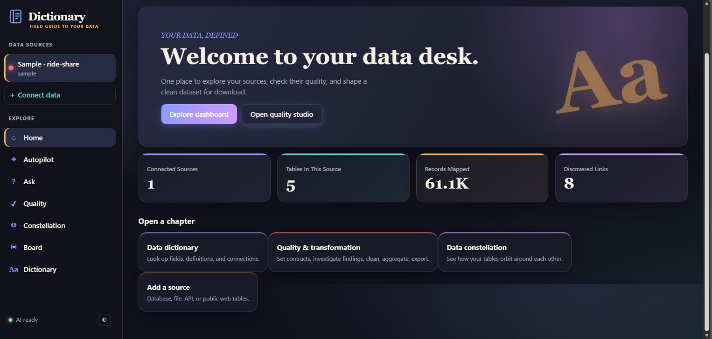
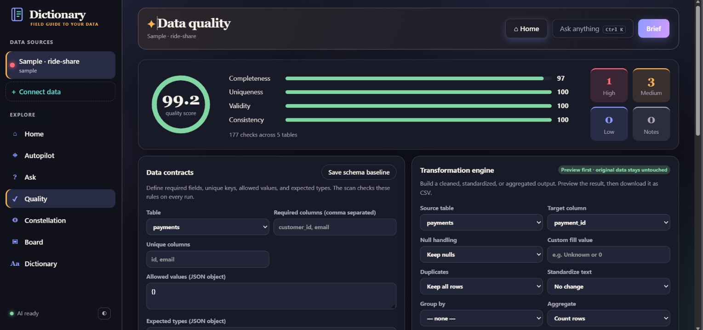
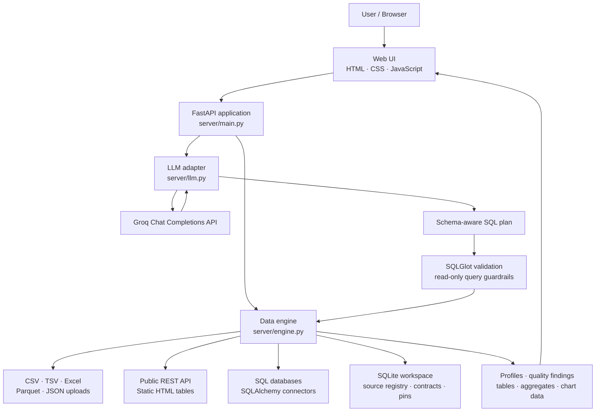

<div align="center">

# ✦ Dictionary

### Your data, defined.

**An AI-powered data exploration, quality, and transformation workspace.**

[](https://dictionary-ai.onrender.com/)
[](https://www.python.org/)
[](https://fastapi.tiangolo.com/)
[](https://render.com/)

**[Launch the app ↗](https://dictionary-ai.onrender.com/)** · **[API docs ↗](https://dictionary-ai.onrender.com/api/docs)** · **[Health check ↗](https://dictionary-ai.onrender.com/api/health)**

</div>

---

## ✨ What is Dictionary?

Dictionary turns disconnected tables and files into a workspace you can **explore, understand, quality-check, query, and transform**—without needing to start by writing SQL manually.

Connect a database, upload files, import JSON from a REST API, or read tables from a public web page. Dictionary profiles the data, discovers relationships, builds a dashboard, flags unusual patterns, and lets you ask questions in plain English. For AI-assisted answers, it uses Groq-hosted LLMs to help generate a read-only SQL query, runs that query through guarded execution, and explains the returned evidence.

> **Try the live demo:** Open Dictionary, load the built-in **Sample · ride-share** source, then explore **Autopilot**, **Ask**, **Quality**, **Constellation**, and **Dictionary** from the left navigation.

## 🚀 Live links

| Resource | Link |
|---|---|
| **Live application** | [dictionary-ai.onrender.com](https://dictionary-ai.onrender.com/) |
| API documentation | [Interactive FastAPI / Swagger docs](https://dictionary-ai.onrender.com/api/docs) |
| Health endpoint | [Service and LLM status](https://dictionary-ai.onrender.com/api/health) |
| Source code | [GitHub repository](https://github.com/lavenya200399/dictionary-ai) |

> **Demo hosting note:** This app is hosted on Render's free web-service tier. The service may take a little time to wake after inactivity. The live demo uses a shared service and is intended for evaluation with non-sensitive sample data—not confidential datasets.

## 🖼️ Product tour

<details open>
<summary><strong>01 · Home — one starting point for your data</strong></summary>



A source overview shows connected sources, discovered tables, mapped records, and inferred links. Shortcuts lead into the dashboard, quality studio, data constellation, dictionary, and source connection flow.
</details>

<details>
<summary><strong>02 · Ask — ask questions in plain English</strong></summary>


Ask questions about the connected dataset. Dictionary uses the available schema and business glossary to formulate a read-only query, executes it through its SQL guardrails, and presents an explanation with supporting rows and a chart when available.
</details>

<details>
<summary><strong>03 · Autopilot — dashboard and insight radar</strong></summary>


Explore automatically generated KPIs, time trends, category breakdowns, and anomaly/trend findings. Insight cards can be used as starting points for follow-up questions.
</details>

<details>
<summary><strong>04 · Quality Studio — validate and transform</strong></summary>



Review completeness, uniqueness, validity, and consistency signals. Define data contracts and schema baselines. Preview null handling, duplicate handling, text standardization, grouping, and aggregation before exporting a transformed CSV. The transformation flow is designed to preview output rather than silently overwrite the source.
</details>

<details>
<summary><strong>05 · Data Dictionary — understand fields quickly</strong></summary>


Browse tables and columns with inferred field roles, descriptions, ranges, categories, and relationships. The dictionary can be searched and exported.
</details>

<details>
<summary><strong>06 · Data Constellation — explore table relationships</strong></summary>


Inspect declared and inferred links across tables. The relationship view helps users understand how entities connect before they investigate a metric or compose a query.
</details>

## 🧭 Feature map

| Area | What it does |
|---|---|
| **Connect data** | Connect supported SQL databases; upload CSV, TSV, Excel, Parquet, or JSON files; import JSON records from a REST API; import static HTML tables from public web pages. |
| **Autopilot** | Generates a dashboard from the connected schema, including KPIs, trends, distributions, and breakdowns. |
| **Insight Radar** | Surfaces statistical and data-quality signals such as unusual changes, trends, concentration, and correlations. These are leads for investigation, not proof of causation. |
| **Ask your data** | Uses an LLM to draft a query from the schema and question, runs it through read-only SQL checks, then explains the returned result. |
| **Trust receipt** | Shows query/evidence details and execution checks associated with an AI answer. |
| **Quality Studio** | Checks completeness, uniqueness, validity, and consistency; inspects findings; previews transformations and exports CSV. |
| **Data contracts** | Define required fields, uniqueness rules, allowed values, and expected types. |
| **Schema baseline** | Save a schema snapshot and compare future scans for changes. |
| **Data Constellation** | Visualizes declared and inferred relationships between tables. |
| **Business glossary** | Define business terms and reuse their definitions when asking questions. |
| **Live Board** | Pin useful SQL-backed cards and revisit them. |
| **Executive brief** | Create a narrated summary of the connected data. |
| **Data Dictionary** | Search and inspect table and column metadata. |

## 🏗️ Architecture

GitHub renders the Mermaid diagram below directly in this README. It shows the main request and data paths at a high level.



### Request flow, in plain English

1. The browser sends a request to the FastAPI backend.
2. The data engine loads the connected source and profiles its tables and columns.
3. For an AI question, the LLM adapter sends the question and schema context to Groq.
4. The proposed SQL is checked by the query-safety layer before execution.
5. The backend returns rows, metadata, chart-ready results, or a transformation preview to the UI.

**Important:** An LLM can make mistakes. The application uses read-only SQL guardrails, but these do not replace least-privilege database credentials, security review, or testing against untrusted inputs.

## 🧰 Technology stack

### Backend and data processing

- **Python** — application logic and data-processing workflows.
- **FastAPI** — HTTP API, request validation, upload endpoints, and API documentation.
- **Uvicorn** — ASGI server used to run the application.
- **Pandas and NumPy** — ingestion, profiling, cleaning, statistics, aggregation, and tabular transformations.
- **SQLAlchemy** — database engines and SQL connections.
- **SQLGlot** — SQL parsing and validation used in the read-only query guard.
- **Requests** — outbound calls to REST APIs, public web pages, and the Groq API.
- **python-multipart** — multipart file-upload handling.
- **openpyxl and PyArrow** — Excel and Parquet file support.
- **psycopg2-binary and PyMySQL** — PostgreSQL and MySQL/MariaDB connectivity.
- **lxml** — HTML table parsing.
- **SQLite** — local queryable storage for imported datasets and application workspace metadata.

### Frontend and visualization

- **HTML5, CSS, and JavaScript** — browser interface and client-side interactions.
- **Chart.js** — charts and visual summaries.
- **Progressive Web App (PWA) metadata** — manifest support for an installable app experience in compatible browsers.

### AI

- **Groq API** — hosted chat-completion inference.
- **`openai/gpt-oss-120b`** — default configured model, overridable through `GROQ_MODEL`.
- **Schema-aware question-to-SQL flow** — sends schema context to the model, validates the resulting query, and summarizes returned evidence.

### Deployment and developer workflow

- **GitHub** — source control and deployment trigger.
- **Render** — hosts the FastAPI web service.
- **Environment variables** — keep the Groq key and runtime configuration out of source code.

## 🔐 Safety and data handling

- The AI query flow is designed around read-only SQL and validates model-generated SQL before execution.
- The engine applies a row cap and query timeout; the defaults in code are configurable.
- Private/internal URL targets are blocked by default for API and web-table imports.
- File uploads have a per-file size limit.
- Use **read-only database credentials** when connecting databases.
- Never commit `.env`, API keys, private datasets, or workspace database files to GitHub.
- Do not use the public demo with personal, regulated, or confidential information.
- This is a portfolio project, not a security-certified enterprise platform. Review authentication, rate limiting, tenant isolation, and persistent storage before inviting unrestricted public usage.

## ⚡ Run locally

### 1. Clone the repository

```bash
git clone https://github.com/lavenya200399/dictionary-ai.git
cd dictionary-ai
```

### 2. Create a virtual environment

**Windows PowerShell**
```powershell
python -m venv .venv
.\.venv\Scripts\Activate.ps1
pip install -r requirements.txt
```

**macOS / Linux**
```bash
python -m venv .venv
source .venv/bin/activate
pip install -r requirements.txt
```

### 3. Configure environment variables

Create a local `.env` file from `.env.example` and set your own key:

```env
GROQ_API_KEY=your_groq_api_key
GROQ_MODEL=openai/gpt-oss-120b
GROQ_REASONING_EFFORT=low
```

Never paste a real API key into this README or commit `.env` to GitHub. AI questions and narrated briefs require a configured, available LLM API. Core profiling and local data operations can run without the LLM key.

### 4. Start the application

```bash
python run.py
```

Open [http://127.0.0.1:8000](http://127.0.0.1:8000).

To inspect the API, open [http://127.0.0.1:8000/api/docs](http://127.0.0.1:8000/api/docs).

## 🎬 A 90-second demo walkthrough

Use this flow for a recruiter screen share or a short screen recording:

| Time | Show | Say |
|---|---|---|
| **0–10 sec** | Home page | “Dictionary is a data exploration workspace that combines profiling, quality checks, visual analytics, and AI-assisted questions.” |
| **10–25 sec** | Connect data / sample source | “It accepts files, database connections, REST JSON, and static HTML tables.” |
| **25–40 sec** | Autopilot | “It builds an initial dashboard and flags unusual patterns so users know where to investigate.” |
| **40–55 sec** | Ask | “I can ask a question in plain English. The LLM proposes SQL, the backend validates it, and the response is grounded in query results.” |
| **55–70 sec** | Quality Studio | “I can define data contracts and preview cleaning or aggregation before exporting the transformed result.” |
| **70–82 sec** | Dictionary / Constellation | “The dictionary explains fields, while the constellation view helps users understand relationships across tables.” |
| **82–90 sec** | Live URL | “The application is deployed as a public demo, with the API key held in server-side environment configuration.” |

**Demo recording:** A video has not been included yet. Record this walkthrough using OBS Studio or Windows Snipping Tool, upload it to YouTube or LinkedIn, then add its URL here.

`[Add demo video URL when recorded]`

## 💼 Portfolio / resume description

**Dictionary — AI-powered Data Exploration & Quality Platform**  
Built and deployed a full-stack data analytics application using Python, FastAPI, Pandas, SQLAlchemy, SQLGlot, Chart.js, and Groq. Implemented multi-source ingestion, automated profiling and dashboard generation, relationship discovery, data-quality checks, schema contracts, transformation previews, CSV export, and natural-language analytics with guarded read-only SQL execution. Deployed the application on Render with secret configuration managed through environment variables.

### Skills demonstrated

`Python` · `FastAPI` · `Pandas` · `NumPy` · `SQL` · `SQLAlchemy` · `SQLGlot` · `REST APIs` · `LLM integration` · `Data quality` · `ETL concepts` · `Data visualization` · `GitHub` · `Render`

## 🗺️ Roadmap

- [ ] Add a short hosted product demo video.
- [ ] Add authentication and per-user workspace isolation.
- [ ] Add persistent storage for production use.
- [ ] Add rate limits and usage budgets for public AI requests.
- [ ] Add automated tests and continuous integration.
- [ ] Add deployment monitoring and structured error reporting.

## 👩‍💻 Author

**Lavenya Ravikumar**

- Portfolio: [lavenya-r-portfolio.netlify.app](https://lavenya-r-portfolio.netlify.app/)
- GitHub: [@lavenya200399](https://github.com/lavenya200399)
- LinkedIn: [Lavenya Ravikumar](https://www.linkedin.com/in/lavenya-ravikumar-35514877/)

---

<div align="center">

**Explore your data. Understand the signal. Transform with confidence.**

[**Launch Dictionary ↗**](https://dictionary-ai.onrender.com/)

</div>
