<p align="center">
  
</p>

<p align="center">
  <a href="https://dictionary-ai.onrender.com/"></a>
</p>

<p align="center">
  <a href="https://github.com/YOUR_USERNAME/dictionary/actions/workflows/ci.yml"></a>
  
  
  
  
  
</p>

<p align="center">
  <b><a href="#try-it-in-60-seconds">Try it</a></b> ·
  <b><a href="#features">Features</a></b> ·
  <b><a href="#architecture">Architecture</a></b> ·
  <b><a href="#how-ask-stays-safe">AI safety</a></b> ·
  <b><a href="#engineering-decisions">Decisions</a></b> ·
  <b><a href="#quick-start">Run locally</a></b> ·
  <b><a href="#api-reference">API</a></b>
</p>

<p align="center">
  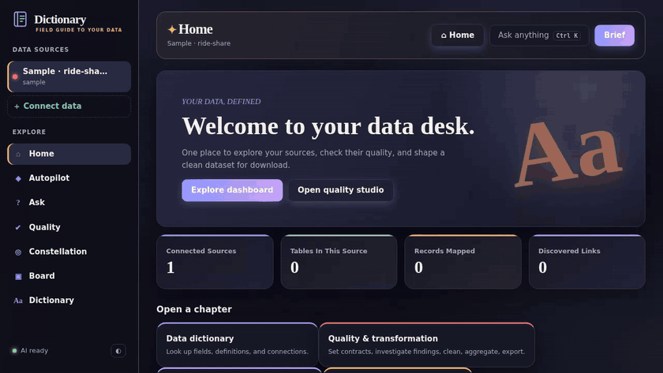
</p>

---

## What is this?

**Dictionary** turns *any* data source into something a business user can understand and trust.

Point it at a database, upload a spreadsheet, call a REST API or paste a link to a web page with tables. It then:

1. **Maps** every table and column and discovers how tables relate, even when no foreign keys exist.
2. **Builds a dashboard automatically** from whatever schema it finds, with KPIs, trends, breakdowns and an *insight radar*.
3. **Audits data quality** with a 0 to 100 score, data contracts, schema-drift alerts, root-cause hints and a safe clean-and-export tool.
4. **Answers questions in plain English**, with a hard safety gate between the AI and your data and a *Trust Receipt* on every answer.

> **The idea in one line:** an AI analyst you can actually trust, because it can only read, and because it shows its work.

### At a glance

| | | | |
|:--:|:--:|:--:|:--:|
| **7** views | **5** source types | **26** REST endpoints | **26** automated tests |
| **7**-step SQL safety gate | **177** quality checks on the sample | **0** writes to your data | **0** setup per dataset |

---

## Try it in 60 seconds

1. Open the **[live demo](https://dictionary-ai.onrender.com/)**. The free host sleeps when idle, so the first load can take ~30 s.
2. Click **Try sample data** (a 5-table ride-share dataset).
3. Open **Autopilot**, then click any bar on any chart to start a question about it.
4. Open **Quality** and press **Inspect rows** on a finding.
5. Open **Constellation** and use **Trace path** to see how two tables connect.
6. Open **Ask** and try *"What explains the drop in users in 2024-06?"* or *"Delete all cancelled rides"* to watch the safety gate say no.

> The hosted demo is a shared sandbox. Please don't upload sensitive data (see [Security](#security-and-limitations)).

---

## Features

<table>
<tr>
<td width="50%" valign="top"><a href="docs/screenshots/home.jpg"></a><br><b>Home: the data desk.</b><br><sub>Sources, tables, records and discovered links at a glance.</sub></td>
<td width="50%" valign="top"><a href="docs/screenshots/autopilot.jpg">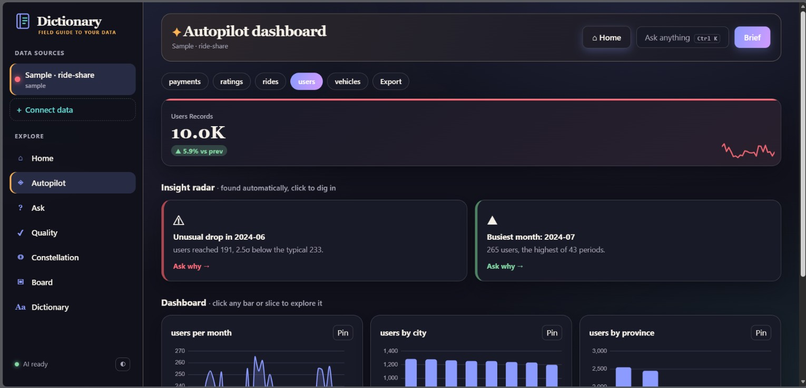</a><br><b>Autopilot: a dashboard with zero setup.</b><br><sub>KPIs with trend deltas, insight radar, charts for every table.</sub></td>
</tr>
<tr>
<td width="50%" valign="top"><a href="docs/screenshots/ask.jpg">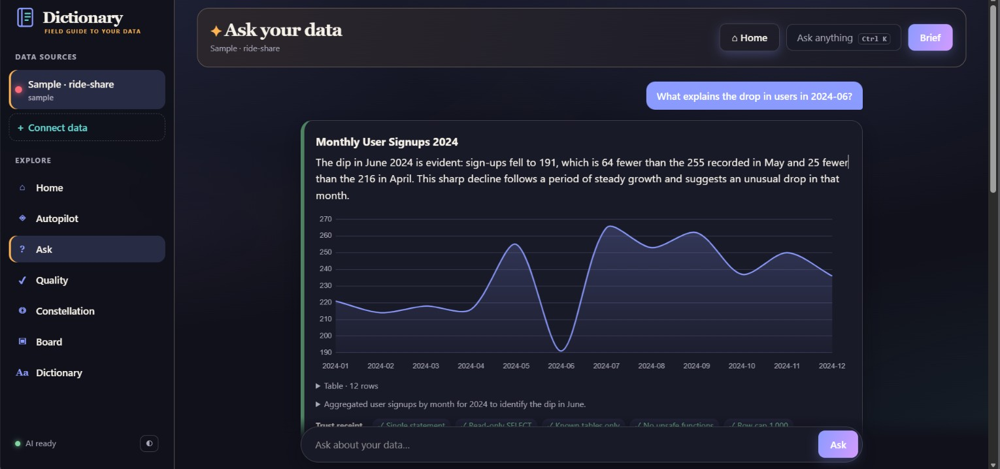</a><br><b>Ask: plain English to safe SQL.</b><br><sub>Auto-chosen chart, plain-language answer, Trust Receipt.</sub></td>
<td width="50%" valign="top"><a href="docs/screenshots/quality.jpg"></a><br><b>Quality studio.</b><br><sub>Score, contracts, drift, transformations, investigation.</sub></td>
</tr>
<tr>
<td width="50%" valign="top"><a href="docs/screenshots/lineage.jpg">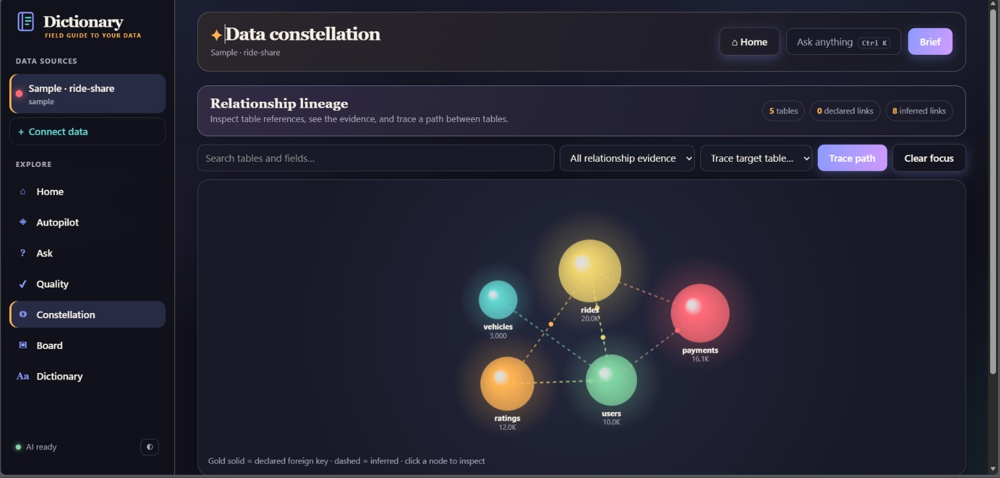</a><br><b>Constellation: relationship lineage.</b><br><sub>Declared vs inferred links, evidence filter, path tracing.</sub></td>
<td width="50%" valign="top"><a href="docs/screenshots/dictionary.jpg">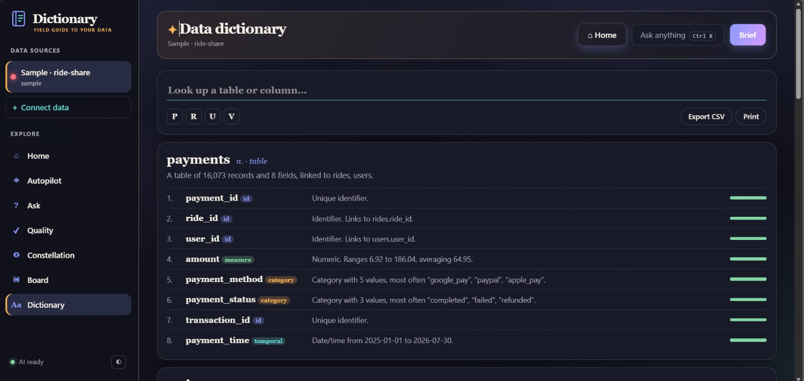</a><br><b>Dictionary: an auto-written data catalog.</b><br><sub>Searchable, A to Z, exportable to CSV.</sub></td>
</tr>
</table>

<details>
<summary><b>Autopilot: the dashboard that builds itself</b></summary>

- Picks the most informative table and a time column automatically, then builds KPIs with period-over-period deltas and sparklines.
- Generates breakdowns for low-cardinality columns and **cross-table charts** by following discovered relationships (for example *rides by rider city*).
- **Insight radar** flags spikes and drops (z-score), trend changes, dominant categories, correlated measures and large data gaps. Every card has an *Ask why →* button.
- **Click any bar or slice** to start a question about it; **pin** any chart to the live Board (re-run on current data each time).
- One-click **executive brief** you can print to PDF.
</details>

<details>
<summary><b>Quality studio: score, contracts, drift, transform, investigate</b></summary>

- **Score 0 to 100** across completeness, uniqueness, validity and consistency, per table and overall (177 checks on the sample; scales with the schema).
- **Data contracts**: required fields, unique keys, allowed values and expected types per table, re-checked on every scan.
- **Schema drift**: save a baseline, then get alerted to missing/new columns, changed types and dropped tables.
- **Inspect rows** shows the exact offending records for any finding, with the SQL behind it.
- **Investigate** compares affected vs healthy rows and shows which other columns the problem clusters in (a root-cause starting point, honestly labelled as association, not proof).
- **Transformation engine**: null handling (drop, fill value/mean/median/mode), de-duplication, text standardisation, group-and-aggregate. **Preview first, download as CSV; the original data is never modified.**
</details>

<details>
<summary><b>Constellation: lineage you can interrogate</b></summary>

- Force-directed map where planet size is row count and glowing links are relationships.
- Links are classified **declared** (foreign key) or **inferred** (same name / matching values), with the evidence shown.
- Search tables and fields, filter by evidence type, and **trace the path** between any two tables.
</details>

<details>
<summary><b>Connect anything</b></summary>

| Source | How |
|---|---|
| Database | Connection URL (PostgreSQL, MySQL, SQLite via SQLAlchemy); queried in place, read-only |
| Files | CSV, TSV, Excel (every sheet becomes a table), JSON, Parquet |
| REST API | Any JSON endpoint, optional auth headers and record path |
| Web tables | A public page with HTML tables (`pandas.read_html`) |
| Sample | One-click 5-table ride-share dataset |

<p align="center">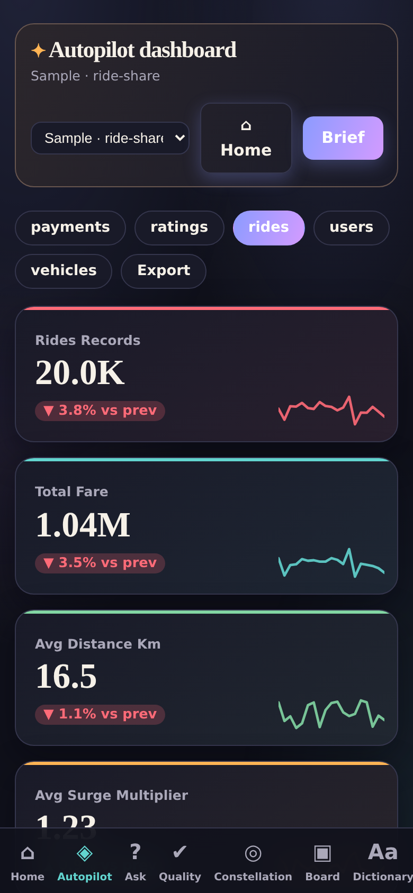</p>
<p align="center"><sub>Fully responsive and installable as a PWA.</sub></p>
</details>

---

## Architecture

<p align="center">
  <a href="docs/assets/architecture.png">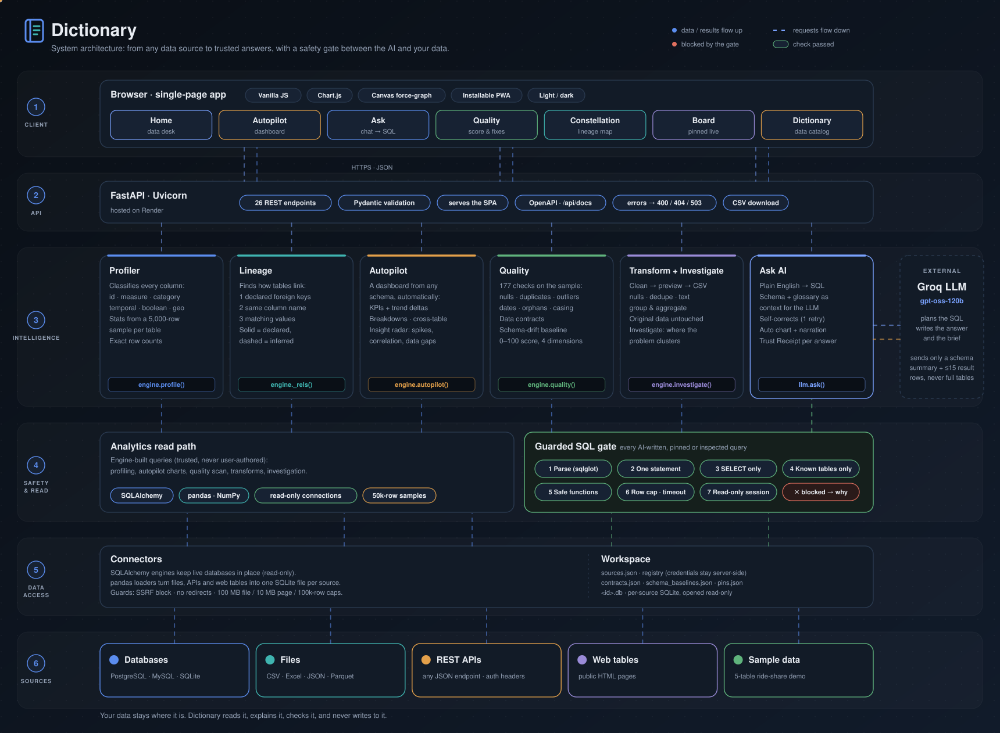</a>
</p>
<p align="center"><sub>Data flows up from sources to the browser; requests flow down. Click the diagram for the high-resolution PNG.</sub></p>

<details>
<summary><b>The same architecture as text (Mermaid)</b></summary>

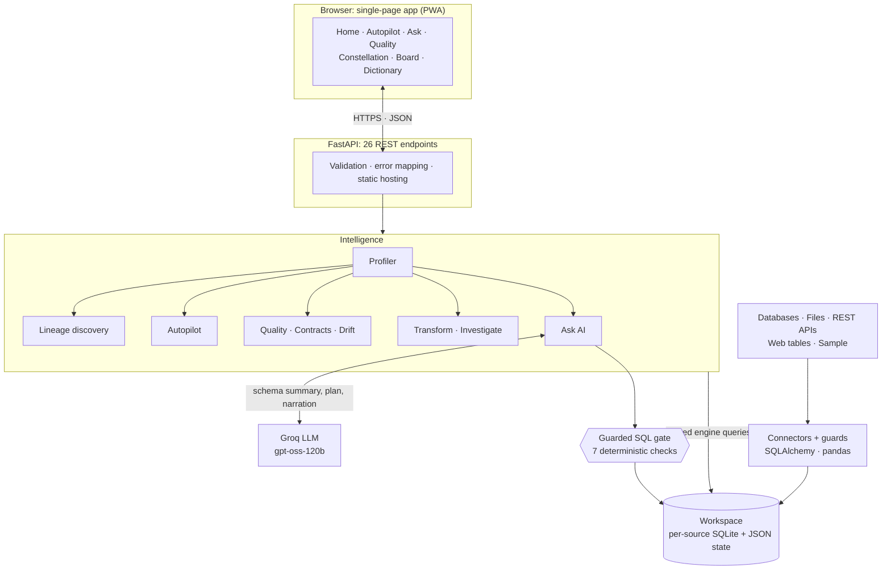
</details>

<details>
<summary><b>Sample data model: all 8 relationships were <i>discovered</i>, none were declared</b></summary>

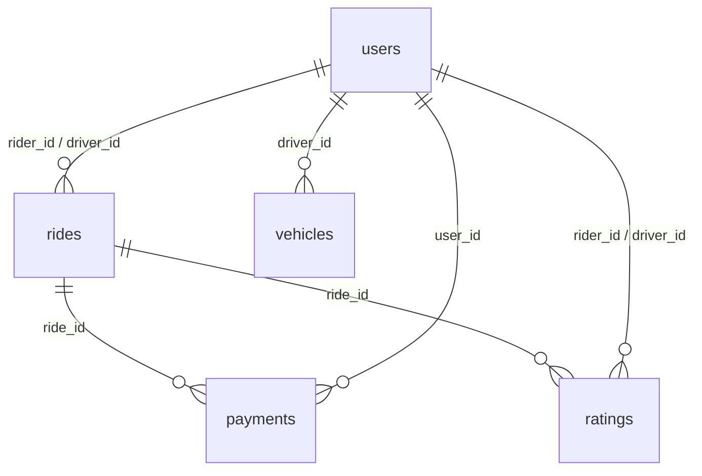
</details>

Full write-up: **[docs/architecture.md](docs/architecture.md)**

---

## How Ask stays safe

<p align="center">
  <a href="docs/assets/ask-pipeline.png">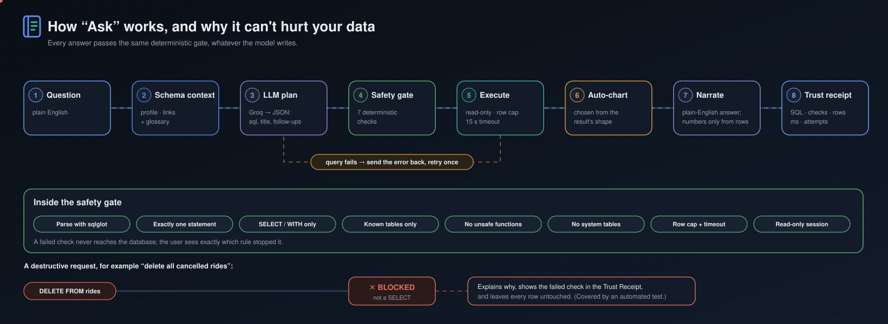</a>
</p>

Language models are good at writing SQL and bad at being trusted with it. So the model is treated as an **untrusted suggestion engine**: whatever it writes must pass a deterministic gate before touching any data.

| Defence | What it does |
|---|---|
| **Parse** | `sqlglot` parses the statement in the source's own dialect; unparsable SQL never runs |
| **One statement, SELECT only** | Rejects `DELETE`, `UPDATE`, `INSERT`, `DROP`, `ALTER`, `PRAGMA`, `INTO`, multi-statement scripts and data-modifying CTEs |
| **Known tables only** | Every table in the query must exist in the profiled schema; system catalogs and `sqlite_master` are blocked |
| **No unsafe functions** | `pg_sleep`, `load_extension`, `pg_read_file`, `dblink`, … are denied |
| **Row cap and timeout** | Results are capped (default 1,000 rows) and queries time out (default 15 s) |
| **Read-only session** | `SET TRANSACTION READ ONLY` for Postgres/MySQL; SQLite files are opened read-only |
| **Grounded narration** | The answer is written from at most 15 result rows, and the chart type is chosen by code, not by the model |
| **Trust Receipt** | Each answer shows its SQL, the checks it passed, rows returned, runtime and whether it self-corrected |

A blocked request is explained, never retried, and leaves every row untouched. That behaviour is covered by an automated test (`tests/test_ask_pipeline.py`).

---

## Data quality engine

<details>
<summary><b>What the scanner checks</b></summary>

| Dimension | Checks |
|---|---|
| **Completeness** | missing values per column, blank-string values, empty columns, empty tables |
| **Uniqueness** | exact duplicate rows, repeated values in key columns |
| **Validity** | extreme outliers (3 × IQR), negative amounts, future dates, end-before-start date pairs, orphaned foreign keys, schema drift |
| **Consistency** | stray whitespace, inconsistent casing (`Halifax` vs `halifax`), numbers stored as text, single-value columns |
| **Contracts** | required, unique, allowed values, expected types |
| **Freshness** | newest record older than 90 days (informational) |

Exact counts are used for nulls, orphans and keys. Heavier checks run on a 50,000-row sample for large tables, and the UI says so.
</details>

---

## Engineering decisions

| Decision | Why | Trade-off |
|---|---|---|
| **Deterministic SQL gate instead of an "LLM judge"** | An early prototype asked a model whether SQL was safe. Parsing is testable, repeatable and cannot be talked out of its answer. | Stricter than necessary for some read-only edge cases (they are rejected, not guessed at). |
| **Profile first, prompt second** | The prompt includes column kinds, real category values, ranges and discovered links, so filters like `status = 'completed'` are right on the first try. | Larger prompts; mitigated by sending a schema *summary*, never data. |
| **Charts chosen by code** | Chart type follows the result's shape (time series → line, ≤5 categories → donut, ranking → bar). Predictable and impossible to hallucinate. | Less flexible than model-designed visuals. |
| **Relationship discovery by value overlap** | Real datasets rarely declare foreign keys (the sample has none). Overlap with a coverage tie-break finds them. | Heuristic: names and values can mislead, so links are labelled *inferred* with evidence. |
| **Normalise everything to read-only SQLite** | One engine and one safety gate for CSV, JSON, APIs and web tables. | Not for huge data; large sources should be connected as live databases. |
| **Exact counts, sampled deep checks** | Keeps the quality scan interactive on big tables. | Some findings are estimates on large tables (disclosed in the UI). |
| **One provider-specific file** | `server/llm.py` is the only place that knows about the LLM vendor; the project started on Gemini and moved to Groq by changing that file. | One provider at a time. |
| **Vanilla JS SPA, no build step** | Zero tooling; FastAPI serves it as static files; deploys anywhere. | No component framework; the single file is large. |
| **JSON files for state** | Zero-ops persistence for a portfolio-scale deployment. | Single-tenant (see roadmap). |

---

## Tech stack

<p>
  
</p>

**Backend:** Python · FastAPI · Uvicorn · Pydantic · SQLAlchemy · sqlglot · pandas · NumPy · lxml · Requests
**AI:** Groq (`openai/gpt-oss-120b`) behind a thin client
**Frontend:** vanilla JavaScript · Chart.js · Canvas · CSS custom properties (light/dark) · PWA manifest
**Quality:** pytest (26 tests, no network or API key required) · GitHub Actions
**Hosting:** Render

---

## Quick start

```bash
git clone https://github.com/YOUR_USERNAME/dictionary.git
cd dictionary

python -m venv .venv
source .venv/bin/activate            # Windows PowerShell: .venv\Scripts\Activate.ps1
pip install -r requirements.txt

cp .env.example .env                 # Windows: copy .env.example .env
# put your key in .env  ->  GROQ_API_KEY=...

python run.py                        # http://127.0.0.1:8000
```

Click **Try sample data**. Everything except typed questions and the narrated brief works **without** an API key.

<details>
<summary><b>Configuration</b></summary>

| Variable | Default | Purpose |
|---|---|---|
| `GROQ_API_KEY` | | Enables Ask and the narrated brief |
| `GROQ_MODEL` | `openai/gpt-oss-120b` | Model used for planning and narration |
| `GROQ_REASONING_EFFORT` | `low` | Reasoning effort passed to the model |
| `ROW_CAP` | `1000` | Max rows returned by any query |
| `QUERY_TIMEOUT_S` | `15` | Per-query timeout |
| `ALLOW_PRIVATE_URLS` | `0` | Set `1` to let API/web sources reach private addresses |
| `HOST` / `PORT` | `127.0.0.1` / `8000` | Server bind address |
</details>

<details>
<summary><b>Deploy to Render</b></summary>

1. Push the repo to GitHub.
2. In Render choose **New → Blueprint** and select the repo (`render.yaml` is included), or use  
   `https://render.com/deploy?repo=https://github.com/YOUR_USERNAME/dictionary`
3. Add `GROQ_API_KEY` in the dashboard (it is marked `sync: false`, so it is never committed).
4. Set a spending limit on your Groq key, since the demo is public.
</details>

---

## Testing

```bash
pip install -r requirements-dev.txt
python -m pytest -q          # 26 passed, ~15 s, no network, no API key
```

| Suite | Proves |
|---|---|
| `test_engine.py` | profiling, relationship discovery, autopilot on any CSV, SSRF guard |
| `test_sql_guard.py` | 8 unsafe statements are rejected; row cap holds; colons and `%` in literals survive |
| `test_quality.py` | every quality check fires on deliberately dirty data and every finding's *Inspect* SQL runs; contracts, drift, investigate and transforms work; **transforms never modify the source** |
| `test_ask_pipeline.py` | with the LLM replaced by a scripted fake: happy path, a **destructive query is blocked and no rows are deleted**, one-shot self-correction, clear error without a key |

CI runs the suite on Python 3.11 and 3.12 for every push and pull request.

---

## API reference

<details>
<summary><b>26 endpoints</b> (interactive docs at <code>/api/docs</code>)</summary>

| Method | Path | Purpose |
|---|---|---|
| GET | `/api/health` | status, LLM availability, row cap |
| GET | `/api/sources` | list sources |
| POST | `/api/sources/db` · `/file` · `/api` · `/web` · `/sample` | connect a database / upload files / REST API / web tables / sample |
| DELETE | `/api/sources/{id}` | remove a source and its pins |
| GET | `/api/sources/{id}/profile` | tables, column kinds, relationships |
| GET | `/api/sources/{id}/autopilot?table=` | KPIs, charts, insights |
| POST | `/api/sources/{id}/ask` | question → guarded SQL → chart → narration → Trust Receipt |
| POST | `/api/sources/{id}/brief` | executive brief |
| POST | `/api/sources/{id}/query` | run a guarded read-only SQL query |
| GET | `/api/sources/{id}/quality` | score, findings, contracts, drift |
| GET · PUT | `/api/sources/{id}/contracts` | read / save a table's data contract |
| POST | `/api/sources/{id}/schema-baseline` | save the schema baseline |
| POST | `/api/sources/{id}/transform/preview` · `/download` | preview / download a cleaned CSV |
| POST | `/api/sources/{id}/investigate` | where a finding clusters |
| GET · POST · DELETE | `/api/sources/{id}/glossary` | business definitions |
| GET · POST · DELETE | `/api/board` | live pinned charts |
</details>

---

## Project structure

```text
dictionary/
├── server/
│   ├── main.py            # FastAPI app: 26 endpoints, validation, error mapping, static hosting
│   ├── engine.py          # connectors, profiler, lineage, autopilot, quality, contracts, drift, transforms, guarded SQL
│   └── llm.py             # LLM client and the ask → guard → execute → narrate pipeline
├── web/                   # single-page app (index.html), PWA manifest, icon
├── sample/                # 5-table ride-share CSVs
├── tests/                 # 26 tests: engine, SQL guard, quality, ask pipeline (LLM mocked)
├── docs/                  # architecture deep-dive, animated diagrams, screenshots
├── .github/workflows/     # CI
├── render.yaml            # one-click Render blueprint
└── requirements.txt · requirements-dev.txt · run.py · .env.example
```

---

## Security and limitations

Being upfront about what this is and isn't:

- **Read-only by design for AI-written SQL**; engine-built analytics queries are trusted code paths, not user input.
- **Single-tenant.** There is no authentication, and state lives in one shared workspace. **The public demo is a shared sandbox, so don't upload sensitive data or real credentials.** For anything beyond a demo, run it locally or behind your own SSO/reverse proxy and use a read-only database user.
- **API and web sources** block private/loopback addresses and redirects (SSRF guard); web import reads static HTML tables only (not JavaScript-rendered pages).
- **Large tables:** deep quality checks run on a 50,000-row sample; transformations are limited to 200,000 rows.
- **Database support:** developed and tested against SQLite; PostgreSQL and MySQL paths (read-only sessions, timeouts) are implemented but not yet covered by integration tests.
- **LLM output** is constrained but not infallible; the Trust Receipt exists so a human can verify.

---

## Roadmap

- [x] Auto-profiling, relationship discovery and lineage tracing
- [x] Autopilot dashboards, insight radar, live board
- [x] Guarded SQL gate and Trust Receipts
- [x] Quality score, data contracts, schema drift, root-cause hints
- [x] Preview-first transformation engine with CSV export
- [x] Web-table and REST API ingestion
- [x] Automated tests and CI
- [ ] Authentication and per-user workspaces
- [ ] Postgres-backed state store
- [ ] Scheduled quality runs with alerts
- [ ] Export contracts to dbt tests / Great Expectations
- [ ] PostgreSQL and MySQL integration tests in CI
- [ ] Streaming answers
- [ ] Docker image

---

## What I learned

- **Treat the model as untrusted input.** Deterministic rails (parse, allow-list, read-only session) beat asking another model to review the first one.
- **Context quality drives answer quality.** Profiling the data first, with real category values and relationships, mattered more than prompt wording.
- **Tests find what demos hide.** The suite uncovered a real bug: single-number answers crashed JSON serialisation because of a NumPy integer, while every grouped answer worked fine.
- **Trust is a UI feature.** Showing the SQL and the checks next to every answer changes how people react to AI output.

---

## Author

**Lavenya Ravikumar**: data & AI engineer
[Portfolio](https://your-portfolio.example) · [LinkedIn](https://www.linkedin.com/in/your-handle) · [Email](mailto:you@example.com)

If this project is useful or interesting, a ⭐ helps others find it.

## License

[MIT](LICENSE)
