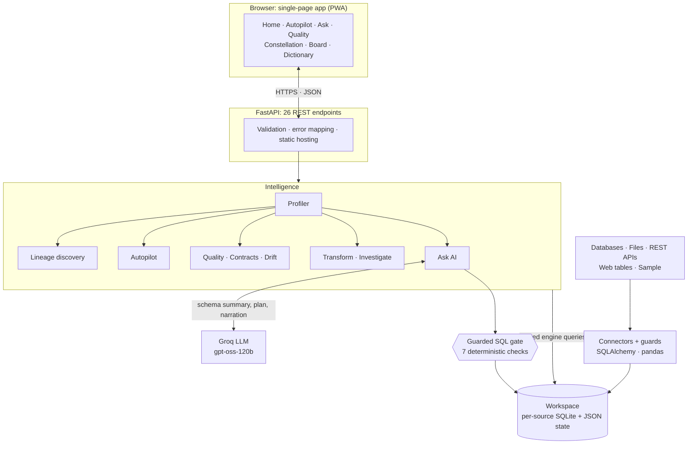
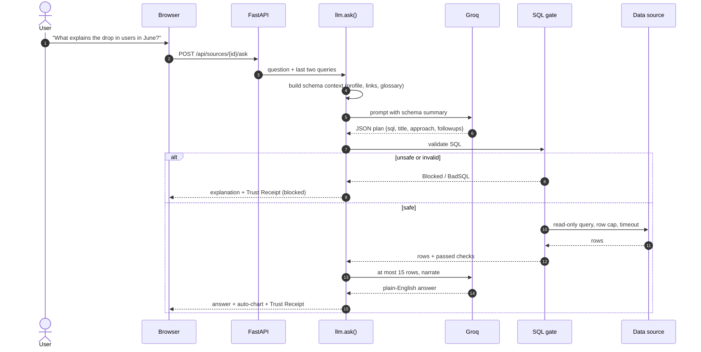
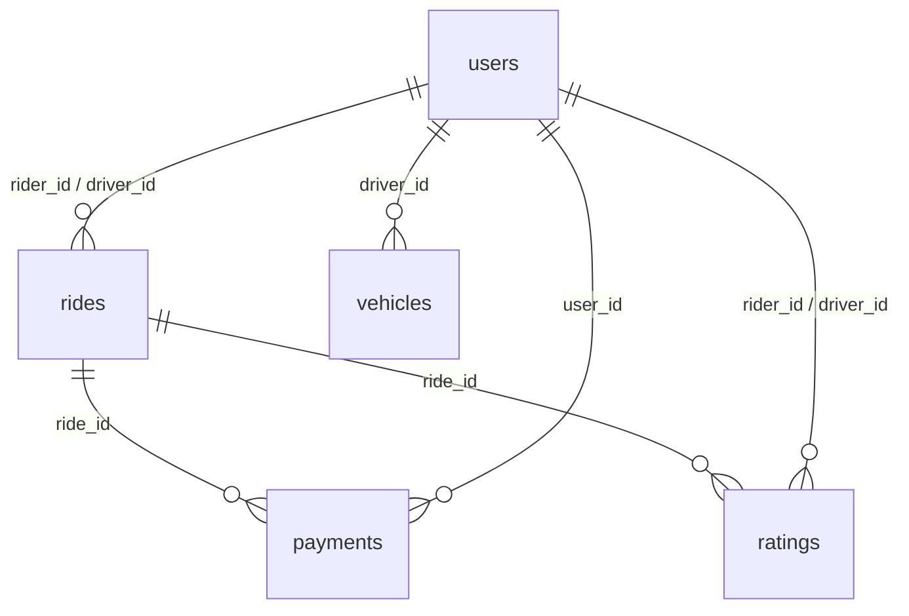

# Architecture

Dictionary is a layered system. Data flows **up** (sources → connectors → engines → API → browser); requests flow **down**.
The one rule that shapes everything: **the AI never touches your data directly.** Everything it writes goes through a deterministic gate first.

## Layers

| # | Layer | Responsibility | Where |
|---|-------|----------------|-------|
| 1 | Client | Single-page app: 7 views, charts, force-graph lineage map, installable PWA | `web/index.html` |
| 2 | API | 26 REST endpoints, validation (Pydantic), error mapping, serves the SPA | `server/main.py` |
| 3 | Intelligence | Profiling, lineage discovery, autopilot dashboards, quality + contracts + drift, transforms, investigation, AI Ask | `server/engine.py`, `server/llm.py` |
| 4 | Safety and read path | Guarded SQL gate for any AI-written / pinned / inspected query; trusted engine-built queries for analytics | `engine.check_sql`, `engine.run` |
| 5 | Data access | Connectors (SQLAlchemy / pandas), ingestion guards, workspace state | `engine.add_*`, `workspace/` |
| 6 | Sources | Databases, files, REST APIs, public web tables, bundled sample | n/a |

## System view

## Request lifecycle: one question

If a query is merely wrong (unknown table, bad column) the error is sent back to the model once for self-correction; a *blocked* query is never retried.

## Data model of the sample dataset (discovered, not declared)

The bundled ride-share data has **no declared foreign keys**; Dictionary finds all 8 relationships itself.

Relationship discovery runs three strategies in order: declared foreign keys (via SQLAlchemy reflection), identical column names against a unique key,
then **value overlap** (≥95 % of sampled child values exist in a candidate parent key, ties broken by coverage).

## Ingestion

| Source | Mechanism | Guards |
|--------|-----------|--------|
| Database URL | SQLAlchemy engine, queried in place | read-only session (Postgres/MySQL), file opened read-only (SQLite) |
| Files | pandas → cleaned column names, ISO dates → one SQLite file per source | 100 MB limit |
| REST API | `requests` → `json_normalize` → SQLite | private/loopback/link-local IPs blocked, no redirects |
| Web tables | `pandas.read_html` (lxml) on static HTML | 10 MB page cap, max 20 tables, same IP guard |
| Sample | bundled CSVs | n/a |

## Workspace state

| File | Contents |
|------|----------|
| `workspace/sources.json` | source registry (connection strings stay server-side) and business glossary |
| `workspace/<id>.db` | per-source SQLite for files, APIs, web tables and the sample |
| `workspace/contracts.json` | data contracts: required, unique, allowed values, expected types |
| `workspace/schema_baselines.json` | saved schemas for drift detection |
| `workspace/pins.json` | board pins (SQL is re-run live; no results are cached) |

## Design decisions and trade-offs

See the table in the [README](../README.md#engineering-decisions).
